

  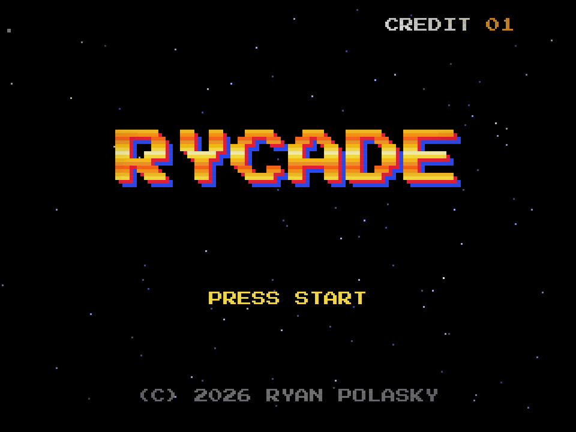

  A custom game frontend for a real four-player arcade cabinet. 

  <a href="https://arcade.ryanpolasky.com">arcade.ryanpolasky.com</a> · <a href="docs/TECHNICAL.md">how it works</a>

---

Rycade lives inside an Arcade1Up NBA Jam cabinet with the stock Android board pulled out. A Mac mini drives the screen, and a Raspberry Pi Pico talks to the cab's original control deck, which turned out to speak a serial protocol rather than plain switches. Pick a game with the stick, press START, and the emulator runs inside the same window: no app switching and no desktop flashing between games. LIVE drops you straight back to the menu.

## The library

  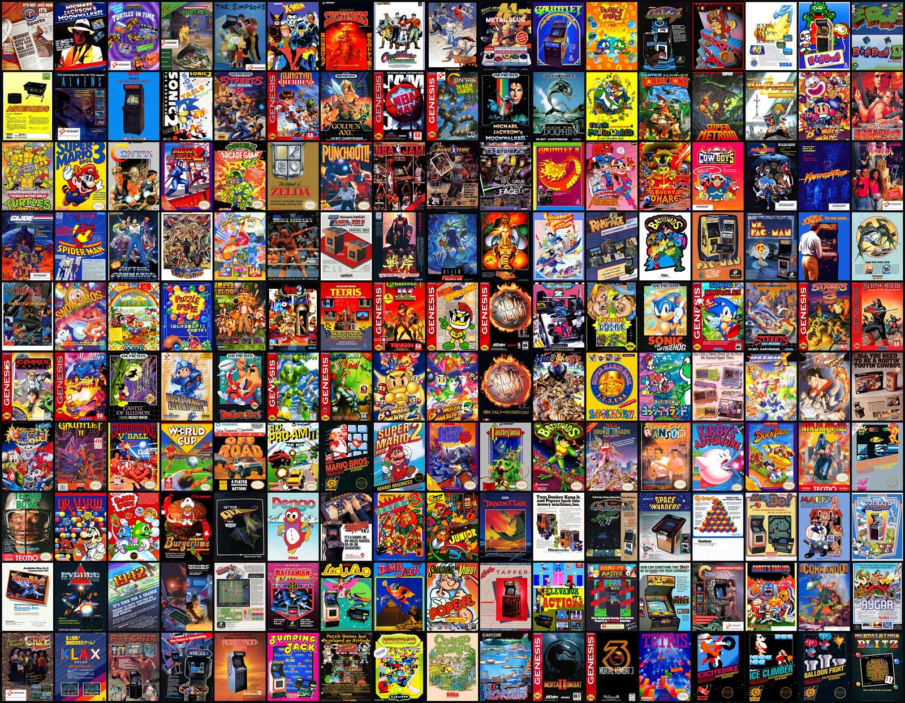

**Way too many games across arcade, Genesis, SNES, NES, and GBA**, chosen to fit four players who each have an 8-way stick, three buttons and START. There are plenty of couch-wreckers (Turtles in Time, The Simpsons, X-Men, Gauntlet, NBA Jam T.E., Bomberman, Micro Machines) next to the classics that come down to who has the high score (Donkey Kong 3, Galaga, Dig Dug, Qix, BurgerTime).

Every game has its real flyer or box art, its marquee logo, and a gameplay clip pulled from archive.org video-snap sets. Super Famicom covers and Japanese flyers stay in where they're the best art available.

## Three looks

| Cover Flow | Shelf | Studio |
| :---: | :---: | :---: |
| 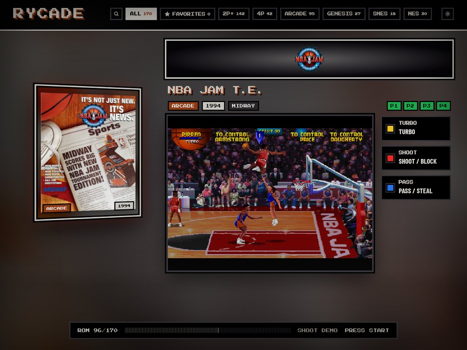 | 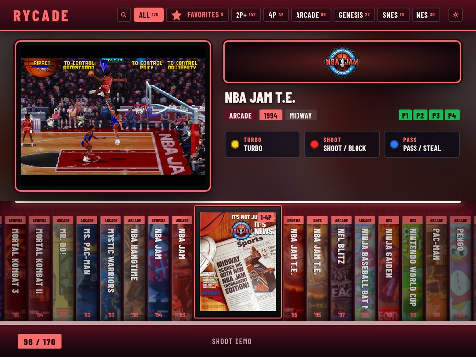 | 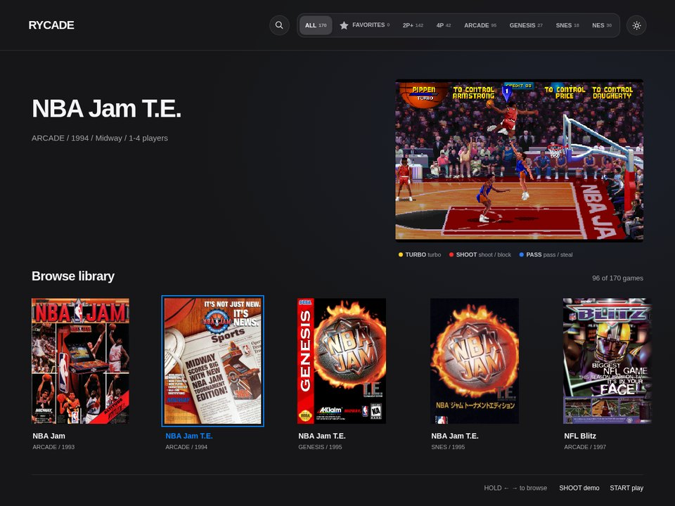 |
| A lit flyer, a marquee and a CRT, tinted by each game's own artwork | A row of spines with the selected game turned face-out | A dark gallery with unframed art |

Cover Flow pulls its colors from the selected game's artwork. Shelf and Studio come in six palettes (Classic, Neon, Phosphor, Amber, Ice, Grape). A CRT filter can go on top of any of them.

## It boots like a machine

Flip the power slider and the cab plays a boot scene instead of showing a desktop. Each scene is drawn live on a canvas and timed to the same synth track, with the big reveal landing on the hit at 4.44 seconds.

| Insert Coin | Lights On | CRT Power-on |
| :---: | :---: | :---: |
|  | 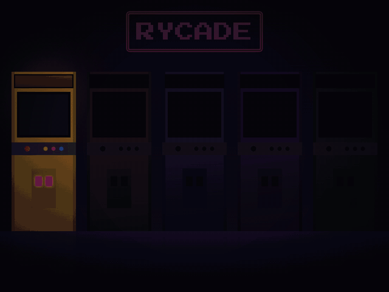 | 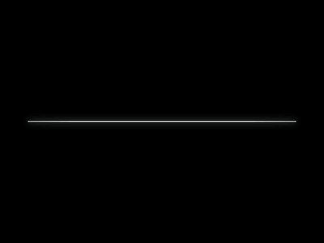 |

## Attract mode

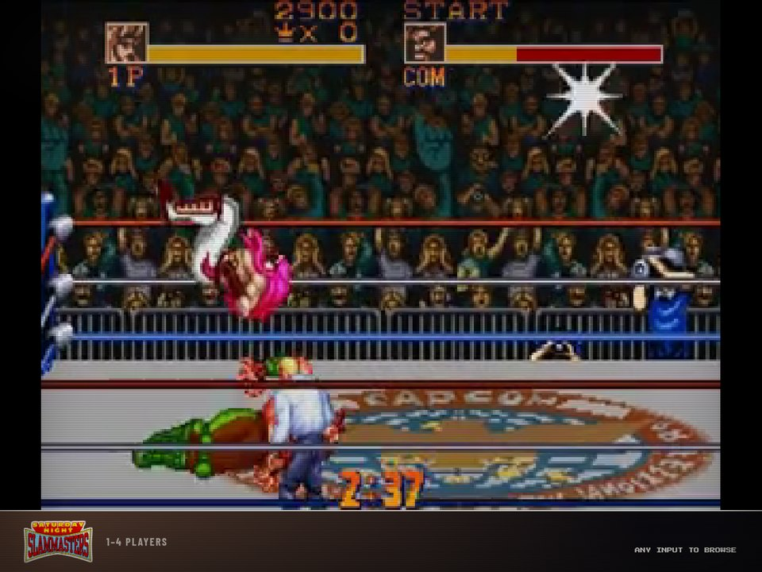

Leave the cab alone for a couple of minutes and it starts cycling full-screen gameplay demos without repeats, the way cabinets do in an arcade. The clips play muted. Touch any control to go back to browsing, or press START to jump to the game that's on screen.

 

## Other niceties

<table>
  <tr>
    <td width="50%">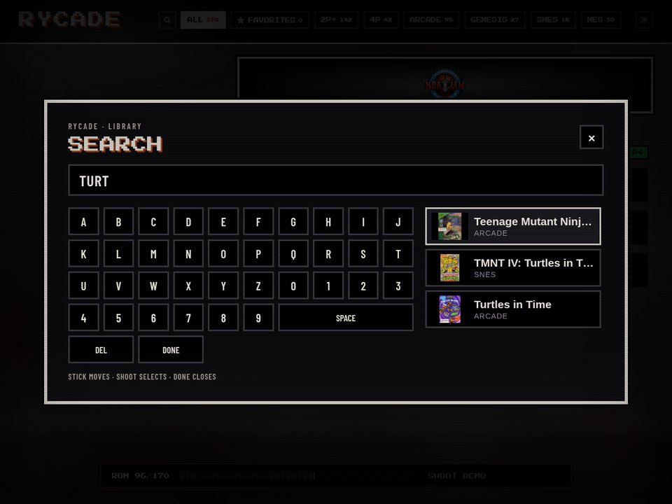</td>
    <td width="50%">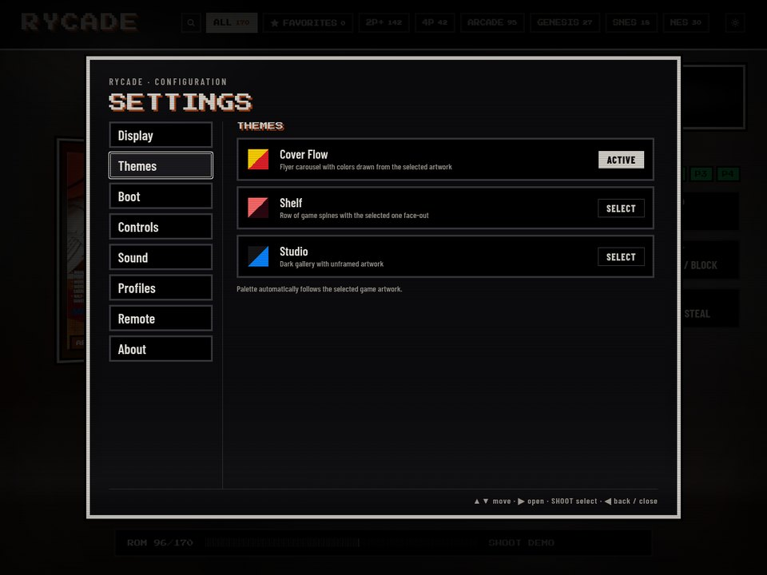</td>
  </tr>
  <tr>
    <td>Search with an on-screen keyboard you drive with the stick. Nobody has to find a real keyboard.</td>
    <td>Every setting is reachable with the stick and three buttons: themes, boot scene, sound, attract timing, and skim speed.</td>
  </tr>
</table>

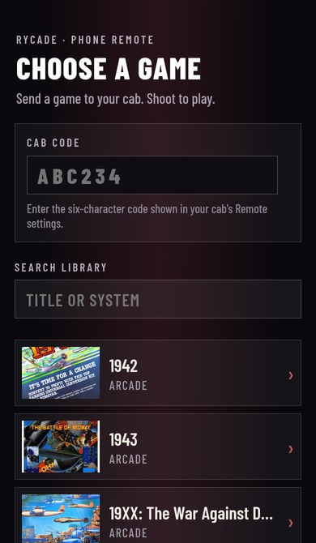

- **Phone remote.** Scan the QR code in settings and you can pick a game from your phone.
- **Hold to skim.** Hold the stick and the list speeds up and jumps by letter.
- **Player profiles.** Pick your initials before games with battery saves (Super Metroid, Zelda, Yoshi's Island), and every player keeps their own save file.
- **High scores.** Arcade high-score tables are read from each game's own save data and posted to [arcade.ryanpolasky.com/scores](https://arcade.ryanpolasky.com/scores). Only the game, initials and score leave the cab.
- **Flexible seats.** In a 1–2 player game, the seat that pressed START becomes Player 1, so you can play solo from either middle stick.
- **Synthesized sounds.** Every blip and confirm is generated with the Web Audio API, in three sound sets (Cabinet, Chip, Neo).
- **Offline by default.** The cab runs a local copy of the frontend behind a firewall that blocks the internet. The only exceptions are score uploads and its remote-access tunnel.

 

## Under the hood

The frontend is plain HTML, CSS and JavaScript with no build step. It runs on a Cloudflare Worker, and on the cab it runs locally in a kiosk Chrome. Games run in-page through [EmulatorJS](https://emulatorjs.org) (MAME 2003-Plus, Genesis Plus GX, Snes9x and FCEUmm). The Pico firmware converts the cab's control deck into USB gamepads, and the NBA Jam deck protocol is [written up here](docs/nba-jam-joystick-board.md).

All the technical detail (controls, architecture, cab setup, firmware, deploys) is in **[docs/TECHNICAL.md](docs/TECHNICAL.md)**.

No ROMs are included. Bring your own legally obtained dumps; [SOURCING.md](SOURCING.md) lists the exact sets Rycade expects.
